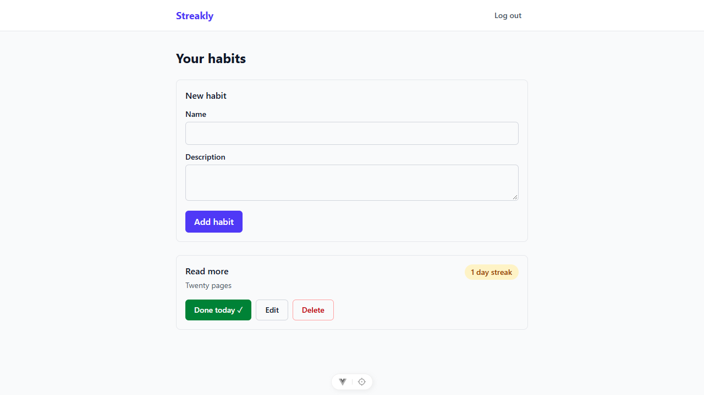

# Streakly

A small habit tracker. Register, create habits, mark a habit done for today and watch its streak grow. It is a learning project for Claude Code workflows and a portfolio piece.

**Stack:** PHP 8.4 · Laravel 13 · Sanctum · SQLite · Pest — Vue 3 · TypeScript · Vite · Pinia · Vue Router · Tailwind CSS 4 · Axios · Vitest



## What it does

- Register, log in and log out with Sanctum Bearer tokens.
- Create, edit and delete your own habits.
- Mark today done or undo it. The server decides what "today" is.
- See each habit's current streak (consecutive days, ending today or yesterday).
- Users only ever see and change their own habits.

## Setup

Requires PHP 8.4, Composer and Node `^22.18 || >=24.12`.

```
# backend
cd backend
composer install
cp .env.example .env
php artisan key:generate
touch database/database.sqlite
php artisan migrate
php artisan serve                # API on http://127.0.0.1:8000

# frontend (second terminal)
cd frontend
npm install
npm run dev                      # SPA on http://localhost:5173, /api proxied to :8000
```

## Tests and checks

```
cd backend && php artisan test               # Pest
cd backend && vendor/bin/pint --test         # code style
cd frontend && npm run test:unit -- --run    # Vitest, single run
cd frontend && npm run lint
cd frontend && npm run type-check
```

## API

All routes live in `backend/routes/api.php` under `/api`, return JSON and use `Authorization: Bearer <token>`.

| Method    | Path                                    | Auth             | Description                                                               | Success |
| --------- | --------------------------------------- | ---------------- | ------------------------------------------------------------------------- | ------- |
| POST      | `/api/register`                         | guest, throttled | Create a user, return `{data: user, token}`                               | 201     |
| POST      | `/api/login`                            | guest, throttled | Check credentials, return `{data: user, token}`. Bad credentials → 422    | 200     |
| POST      | `/api/logout`                           | token            | Revoke the current token                                                  | 204     |
| GET       | `/api/user`                             | token            | Current user                                                              | 200     |
| GET       | `/api/habits`                           | token            | Your habits, oldest first, with `current_streak` and `is_completed_today` | 200     |
| POST      | `/api/habits`                           | token            | Create a habit (`name` required, `description` optional)                  | 201     |
| GET       | `/api/habits/{habit}`                   | token + policy   | Show one habit                                                            | 200     |
| PUT/PATCH | `/api/habits/{habit}`                   | token + policy   | Update name/description                                                   | 200     |
| DELETE    | `/api/habits/{habit}`                   | token + policy   | Delete the habit and its completions                                      | 204     |
| PUT       | `/api/habits/{habit}/completions/today` | token + policy   | Mark today done (idempotent), return the habit                            | 200     |
| DELETE    | `/api/habits/{habit}/completions/today` | token + policy   | Unmark today (idempotent), return the habit                               | 200     |

## Design decisions and trade-offs

- **Bearer tokens in `localStorage`.** The SPA keeps the Sanctum token in `localStorage`. That is exposed to XSS, which is acceptable for this app. Tokens expire after 30 days and expired ones are pruned daily.
- **One fixed habit timezone.** "Today" is computed in `config('streakly.timezone')` (default `Europe/Istanbul`), while timestamps stay in UTC. The app supports a single timezone. `completed_on` is stored as a plain `Y-m-d` string with no date cast, so writes, lookups and the unique index always agree.
- **Idempotent completion endpoints.** Marking uses `PUT` and unmarking uses `DELETE`, so double clicks are harmless. The client never sends a date.
- **403 rather than 404 for other users' habits.** `HabitPolicy` returns 403, which reveals that a habit ID exists. That is a deliberate choice for this app.
- **Policies, FormRequests and API Resources everywhere.** No manual user checks in controllers.
- **Emails are trimmed and lowercased** before use, because SQLite compares them case-sensitively.

## Known limitations

- `/api/register` reveals whether an email is already taken.
- There is no trusted-proxy configuration. Behind a proxy, the per-IP throttles share one bucket.
- Token pruning needs `php artisan schedule:run` to run every minute in production.
- Single timezone only (see above).

## Built with Claude Code

The repo's `.claude/` folder holds the workflow used to build it:

- **Skills:** `api-endpoint`, `frontend-feature`, `phase`, `finish-phase`, `review-pr` and `browser-check` encode the conventions and the per-phase routine.
- **Subagent:** `test-runner` runs Pest or Vitest and reports only the outcome and failures.
- **Hooks:** `guard-bash.sh` screens shell commands and `format.sh` runs Pint and Prettier after edits.
- **MCP:** Laravel Boost (docs search, schema, logs) and context7 (library docs).
- **Rules:** `.claude/rules/clean-code.md`, plus the project instructions in `CLAUDE.md`.

The build plan is in [docs/plan.md](docs/plan.md).
